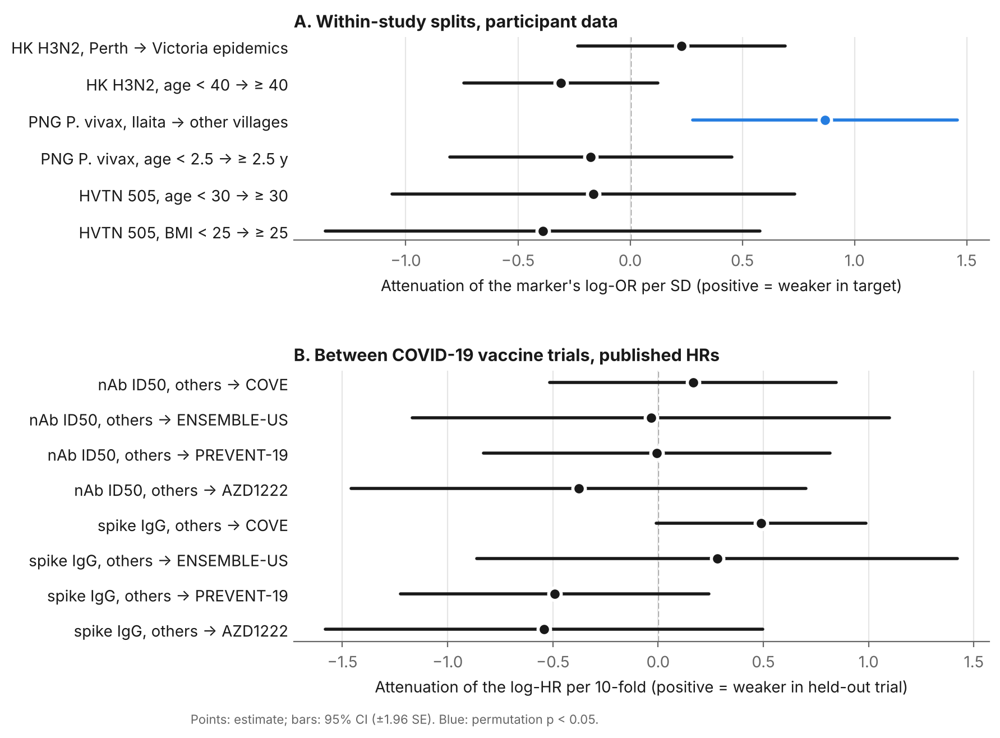

# borrowed-light

Measures how much a correlate-of-protection model loses when it is borrowed across a gap:
another study, platform, population, or a much smaller cohort.

```
fit        m = model(source_train)
baseline   b = evaluate(m, source_heldout)   # what the model is worth at home
transfer   t = evaluate(m, target)           # what it is worth across the gap
penalty    = b - t                           # per metric, with a bootstrap interval
```

## Install

```
pip install -e ".[test]"
pytest
```

## Run

```
python -m experiments.e2_within_study experiments/configs/e2_hvtn505_age.yaml \
    --data /path/outside/repo
```

Each run writes `penalties.csv`, `bootstrap_draws.csv`, `report.md` and a manifest.
Participant data stays outside the checkout, and a run reports aggregate numbers only.

## Results so far



- **Within-study splits (A): a correlate can lose almost all its predictive power across a
  gap.** In the PNG *P. vivax* cohort (natural immunity), the antibody that predicts protection in Ilaita
  loses nearly all of its effect in the other villages (attenuation +0.87 per SD, about 100%
  of the home effect; 95% CI +0.28 to +1.46, permutation p = 0.004). The other five splits
  are inconclusive, not reassuring. HVTN 505 has 12–14 cases a side, AMP has no home signal
  (not shown), and HK H3N2's intervals are wide enough to include total loss.
- **Between COVID-19 trials (B):** neutralising titre transfers across four platforms with no
  detectable penalty (between-trial SD τ ≈ 0, upper bound 0.49 per 10-fold). Spike IgG
  transfers less cleanly (τ = 0.26, COVE slope about half the others), but this is not
  significant. Published influenza HAI data put the between-study SD at about 29% of the slope.
- **Power:** detecting a 50% loss needs roughly 55 / 150 / 650 events a side at home AUC
  0.8 / 0.7 / 0.6 (80% power). The recommended primary estimand is coefficient attenuation
  (the spikes compute it; the `penalty/` estimator does not yet). Next data: Vivli dengue
  and RTS,S requests.

Details: [`docs/power-and-framing.md`](docs/power-and-framing.md),
[`docs/summary-level-pooling.md`](docs/summary-level-pooling.md). Figure:
`python docs/figures/make_results_figure.py`.

## More

- [`SPEC.md`](SPEC.md): the design
- [`docs/literature-review.md`](docs/literature-review.md): the background
- [`docs/data-access.md`](docs/data-access.md): which datasets are public and how to request the rest
- `penalty/` holds the estimator, `sim/` the simulator, `experiments/` the runs and their configs
